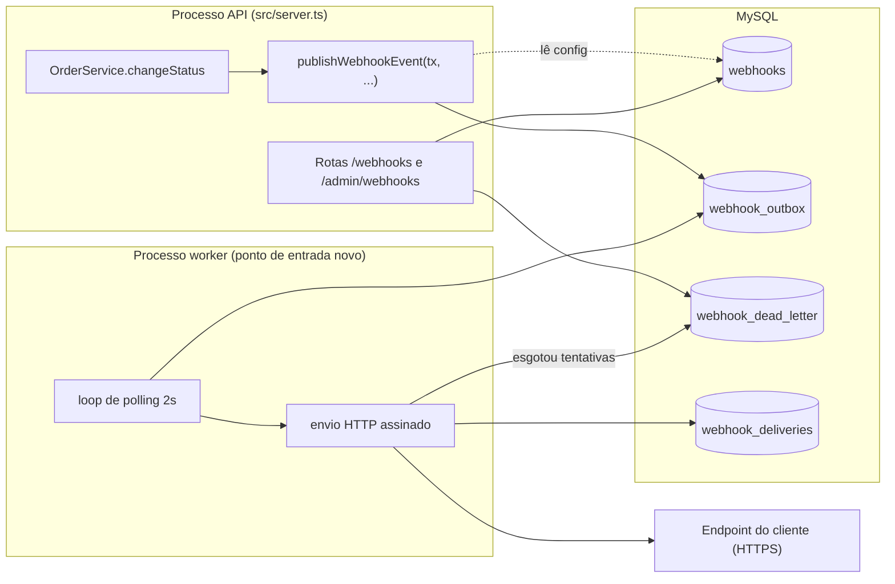

# FDD: Webhooks de notificação de mudança de status de pedidos

| Campo | Valor |
| --- | --- |
| **Autor** | `<autor>` |
| **Status** | Em revisão |
| **Data** | não informada (a reunião de origem registra apenas "quinta-feira, 09:00") |
| **Documentos relacionados** | [RFC](RFC.md) · [ADRs](adrs/README.md) · [PRD](PRD.md) |

> **Legenda de origem:**
> - `([hh:mm] Nome)`: decidido ou citado na reunião ([TRANSCRICAO.md](../TRANSCRICAO.md)).
> - `[ADR-NNN]`: decisão formalizada.
> - `caminho/arquivo`: convenção do código existente.
> - **(proposta)**: especificação do autor deste documento, a validar na revisão.

## 1. Contexto e motivação técnica

Clientes B2B consultam `GET /api/v1/orders` periodicamente para descobrir mudanças de status. A feature passa a avisá-los, por HTTP, em menos de 10s ([09:00] Marcos, [09:02] Marcos). O contexto de negócio e a proposta de arquitetura estão no [RFC](RFC.md).

Duas restrições técnicas do sistema atual moldam a implementação:

- **A mudança de status é uma transação interativa do Prisma** (`src/modules/orders/order.service.ts`, `changeStatus`, L131). Essa transação já valida a transição, ajusta o estoque, atualiza o pedido e grava o histórico. O evento precisa nascer dentro dela, sem chamada HTTP ([ADR-001](adrs/ADR-001-outbox-no-mysql.md), [ADR-007](adrs/ADR-007-integracao-changestatus-transacional.md)).
- **Não existe processo de background no projeto.** O único ponto de entrada é `src/server.ts`, e o worker será o segundo ([ADR-002](adrs/ADR-002-worker-separado-polling-2s.md)).

## 2. Objetivos técnicos

| # | Objetivo | Origem |
| --- | --- | --- |
| OT-1 | Latência entre o commit da mudança de status e a primeira tentativa de entrega abaixo de 10s; o polling dá 2s no pior caso, mais o tempo de processamento | [09:02] Marcos, [ADR-002] |
| OT-2 | Nenhuma mudança de status sem evento e nenhum evento sem mudança de status | [ADR-001], [ADR-007] |
| OT-3 | Entrega at-least-once, com `X-Event-Id` estável entre tentativas | [ADR-005] |
| OT-4 | Ordem de entrega preservada por pedido, para cada endpoint, no caminho sem falhas; com retry, depende da Q11 | [ADR-008] |
| OT-5 | 5 retentativas com backoff de 1m/5m/30m/2h/12h, timeout de 10s por chamada, DLQ e replay manual | [ADR-003] |
| OT-6 | Corpo assinado com HMAC-SHA256 e secret por endpoint, com rotação e 24h de convivência | [ADR-004] |
| OT-7 | Nenhuma alteração em `error.middleware.ts`, `auth.middleware.ts` e `validate.middleware.ts` | [ADR-006] |

## 3. Escopo e exclusões

### Dentro do escopo

- CRUD de configuração de webhooks por cliente, com filtro dos status que cada endpoint quer ouvir ([09:31] Marcos, [09:33] Bruno, [09:33] Marcos).
- Rotação de secret ([09:21] Sofia).
- Histórico de entregas por endpoint ([09:34] Marcos).
- Gravação do evento na outbox dentro de `changeStatus` ([ADR-007]).
- Worker de entrega com retry, DLQ e replay administrativo ([ADR-002], [ADR-003]).
- URL obrigatoriamente HTTPS ([09:23] Sofia).
- Limite de 64KB no payload, com erro em vez de truncar ([09:24] Larissa).

### Fora do escopo

| Item | Origem |
| --- | --- |
| Webhooks inbound | [09:02] Marcos |
| E-mail ao cliente quando o webhook falha (próxima fase) | [09:37] Larissa |
| Painel visual (projeto do time de frontend) | [09:40] Larissa |
| Arquivamento das linhas entregues da outbox | [09:08] Diego |
| Vários workers em paralelo | [09:13] Diego |
| Rate limiting de saída (observar antes de decidir) | [09:39] Larissa |
| Autorização mais restrita para o CRUD de configuração | [09:37] Sofia |

## 4. Visão geral da solução



| Componente | ADR |
| --- | --- |
| Outbox | [ADR-001](adrs/ADR-001-outbox-no-mysql.md) |
| Worker | [ADR-002](adrs/ADR-002-worker-separado-polling-2s.md) |
| Retry e DLQ | [ADR-003](adrs/ADR-003-retry-backoff-exponencial-e-dlq.md) |
| Assinatura | [ADR-004](adrs/ADR-004-hmac-sha256-secret-por-endpoint.md) |
| Semântica de entrega | [ADR-005](adrs/ADR-005-at-least-once-x-event-id.md) |
| Padrões do projeto | [ADR-006](adrs/ADR-006-reuso-padroes-do-projeto.md) |
| Integração com `changeStatus` | [ADR-007](adrs/ADR-007-integracao-changestatus-transacional.md) |
| Ordem | [ADR-008](adrs/ADR-008-ordering-single-worker-por-order-id.md) |

## 5. Modelo de dados

O modelo segue as convenções de `prisma/schema.prisma`:

- id `String @id @default(uuid()) @db.Char(36)`, porque "tudo é uuid" ([09:51] Larissa);
- campos em camelCase;
- tabelas em snake_case via `@@map`;
- `createdAt` e `updatedAt`.

Os nomes `webhook_outbox` e `webhook_dead_letter` foram citados na reunião ([09:06] Diego, [09:18] Diego). Os demais nomes são **(proposta)**.

```prisma
enum WebhookOutboxStatus {
  PENDING      // pendente
  PROCESSING   // processando
  DELIVERED    // entregue
  FAILED       // falhou definitivamente, copiado para a DLQ
}

model Webhook {                                   // (proposta)
  id                      String    @id @default(uuid()) @db.Char(36)
  customerId              String    @db.Char(36)
  url                     String    @db.VarChar(2048)
  events                  Json      // array de OrderStatus, ex.: ["SHIPPED","DELIVERED"]
  secret                  String    @db.VarChar(128)
  previousSecret          String?   @db.VarChar(128)
  previousSecretExpiresAt DateTime?
  active                  Boolean   @default(true)
  createdAt               DateTime  @default(now())
  updatedAt               DateTime  @updatedAt

  customer   Customer            @relation(fields: [customerId], references: [id])
  outbox     WebhookOutbox[]
  deliveries WebhookDelivery[]
  deadLetter WebhookDeadLetter[]

  @@index([customerId, active])
  @@map("webhooks")
}

model WebhookOutbox {
  id            String              @id @default(uuid()) @db.Char(36) // = X-Event-Id
  webhookId     String              @db.Char(36)
  orderId       String              @db.Char(36)
  eventType     String              @db.VarChar(64)
  payload       Json                // snapshot renderizado na inserção
  status        WebhookOutboxStatus @default(PENDING)
  attempts      Int                 @default(0)
  nextAttemptAt DateTime            @default(now())
  lastError     String?             @db.VarChar(500)
  deliveredAt   DateTime?
  createdAt     DateTime            @default(now())
  updatedAt     DateTime            @updatedAt

  webhook    Webhook            @relation(fields: [webhookId], references: [id], onDelete: Cascade)
  deliveries WebhookDelivery[]
  deadLetter WebhookDeadLetter?

  @@index([status, nextAttemptAt, createdAt])
  @@index([createdAt])
  @@map("webhook_outbox")
}

model WebhookDelivery {                           // (proposta)
  id           String   @id @default(uuid()) @db.Char(36)
  webhookId    String   @db.Char(36)
  outboxId     String   @db.Char(36)
  attempt      Int
  success      Boolean
  statusCode   Int?
  durationMs   Int
  responseBody String?  @db.Text   // truncado em 2KB
  error        String?  @db.VarChar(500)
  createdAt    DateTime @default(now())

  webhook Webhook       @relation(fields: [webhookId], references: [id], onDelete: Cascade)
  outbox  WebhookOutbox @relation(fields: [outboxId], references: [id], onDelete: Cascade)

  @@index([webhookId, createdAt])
  @@map("webhook_deliveries")
}

model WebhookDeadLetter {
  id           String    @id @default(uuid()) @db.Char(36)
  outboxId     String    @unique @db.Char(36)
  webhookId    String    @db.Char(36)
  payload      Json
  reason       String    @db.VarChar(500)
  failedAt     DateTime  @default(now())
  replayedAt   DateTime?
  replayedById String?   @db.Char(36)

  webhook Webhook       @relation(fields: [webhookId], references: [id], onDelete: Cascade)
  outbox  WebhookOutbox @relation(fields: [outboxId], references: [id], onDelete: Cascade)

  @@index([webhookId, failedAt])
  @@map("webhook_dead_letter")
}
```

Em `Customer`, acrescenta-se a relação `webhooks Webhook[]`.

**Notas de modelagem:**

- **Estados da outbox.** São os quatro citados na reunião: pendente, processando, falhou e entregue ([09:08] Diego).
- **Uma linha de outbox por evento e por endpoint interessado (proposta).** Cada endpoint tem secret, `X-Webhook-Id`, tentativas e histórico próprios. O `id` da linha é o `X-Event-Id`, gerado na inserção ([ADR-005], [09:25] Diego). Com isso, um cliente com dois endpoints recebe o mesmo evento com ids diferentes, um por endpoint.
- **Índices:**
  - `(status, nextAttemptAt, createdAt)` atende a busca do worker. A reunião citou índice em status e em created_at ([09:08] Diego).
  - `(createdAt)` atende o arquivamento futuro.
- **`events` como `Json` (proposta).** O Prisma no MySQL não tem array de enum. A validação dos valores fica no schema Zod.
- **Secret armazenada em texto (proposta).** O HMAC precisa da secret original, então não dá para guardar um hash. Cifrar em repouso exigiria uma chave nova de infraestrutura. Fica como questão Q6 para a revisão de segurança ([09:46] Sofia).
- **`FAILED` em vez de apagar a linha (proposta).** O worker só lê `PENDING`, então a leitura da outbox continua limpa ([09:18] Diego). A linha é mantida para que o replay reaproveite o mesmo `X-Event-Id`.

## 6. Fluxos detalhados

### 6.1 Criação do evento na outbox

Gatilho: `PATCH /api/v1/orders/:id/status` com transição válida (`src/modules/orders/order.routes.ts`).

1. `changeStatus` executa o fluxo que já existe: busca o pedido, valida a transição (`order.status.ts`), ajusta o estoque, `tx.order.update` e `tx.orderStatusHistory.create` (`order.service.ts` L132–167).
2. **Novo passo**, logo depois de `tx.orderStatusHistory.create` (L159–167): `await publishWebhookEvent(tx, { order, fromStatus: from, toStatus: to })` ([09:41] Bruno, [ADR-007]).
3. `publishWebhookEvent` busca os webhooks `active = true` do `order.customerId` com `tx.webhook.findMany` e mantém os que têm `toStatus` em `events`. O filtro roda em memória **(proposta)**, porque o volume de endpoints por cliente é pequeno. Se nenhum webhook se interessa pelo status, a função retorna sem gravar nada ([09:34] Bruno).
4. O payload é renderizado uma vez, a partir do `order` já carregado no passo 1. Ele usa `orderNumber`, `customerId` e `totalCents`, que a mudança de status não altera ([09:52] Larissa, [ADR-001]). O formato está em §7.10.
5. Grava uma linha `PENDING` em `webhook_outbox` por webhook interessado, com `nextAttemptAt = now()` (`tx.webhookOutbox.createMany`).
6. A transação faz commit, e o worker vê os eventos no próximo ciclo.

**Caminhos de falha:**

- Qualquer erro nos passos 3 a 5 desfaz a transação inteira. O status não muda, o estoque volta e a API responde 500 `INTERNAL_SERVER_ERROR` pelo middleware existente ([09:40] Bruno, [ADR-007]).
- A transação interativa do Prisma tem timeout padrão de 5s. O passo novo acrescenta uma leitura e uma escrita em lote, uma folga que se considera suficiente **(proposta; ver risco R-6)**.

### 6.2 Processamento pelo worker

O worker é um processo separado, iniciado por `npm run worker` ([09:11] Larissa). Ele usa o `prisma` de `src/config/database.ts`, que nesse processo é uma instância própria ([09:30] Bruno).

1. **Recuperação na inicialização e a cada ciclo (proposta).** Linhas em `PROCESSING` com `updatedAt` de mais de 5 minutos voltam para `PENDING`. Elas indicam um worker que caiu no meio do envio, o que pode gerar reenvio; isso é aceito pelo at-least-once ([ADR-005]).
2. **A cada 2s** ([09:09] Diego), busca até `WEBHOOK_BATCH_SIZE` linhas **(proposta: 20)** com `status = PENDING AND nextAttemptAt <= now()`, ordenadas por `createdAt ASC` ([09:12] Diego). Cada linha é reservada com `updateMany({ where: { id, status: 'PENDING' }, data: { status: 'PROCESSING' } })`. A linha só é processada se `count === 1`.
3. Carrega o webhook. Se ele estiver inativo, a linha vai para a DLQ com o motivo `WEBHOOK_INACTIVE`, sem envio **(proposta)**.
4. Serializa o payload. Se passar de 64KB, vai para a DLQ com o motivo `WEBHOOK_PAYLOAD_TOO_LARGE`, sem envio e sem retry ([09:23] Sofia, [09:24] Larissa). O limite é checado no envio, e não na inserção, para não bloquear a mudança de status **(proposta)**.
5. Assina o corpo (§9.3) e envia um `POST` para `webhook.url` com os headers de §7.10 e timeout de 10s ([09:42] Diego). Usa o `fetch` nativo do Node ≥ 20 (`package.json` → `engines`) com `AbortSignal.timeout`, sem seguir redirects **(proposta)**.
6. Grava uma linha em `webhook_deliveries` com a tentativa, o status, a duração, a resposta (até 2KB) e o erro.
7. **Resposta 2xx:** marca a linha como `DELIVERED`, com `deliveredAt = now()`.
8. **Não 2xx, timeout ou erro de rede:** segue o fluxo de retry (§6.3).
9. Os eventos do lote são processados **sequencialmente**, o que preserva a ordem de `createdAt` ([09:12] Diego, [ADR-008]). Um evento em backoff não segura os seguintes: com retry, a ordem por pedido pode se inverter (§9.4, Q11).

**Desligamento:** em `SIGINT` ou `SIGTERM`, o worker termina o envio em curso, para o loop e chama `prisma.$disconnect()`, no mesmo padrão de `src/server.ts` L13–21.

### 6.3 Retry

1. Incrementa `attempts` e grava `lastError` com o código do motivo (§8.2).
2. A tentativa inicial falhou e a contagem de retentativas ainda é menor que 5: `nextAttemptAt = now() + BACKOFF[attempts - 1]`, com `BACKOFF = [1m, 5m, 30m, 2h, 12h]`, e a linha volta para `PENDING` ([09:17] Diego, [ADR-003]).
3. A quinta retentativa falhou (`attempts = 6`: a tentativa inicial mais 5 retentativas): segue para a DLQ (§6.4).

O cálculo é a interpretação deste documento para "5 tentativas, 1m/5m/30m/2h/12h". Os cinco intervalos somam cerca de 14h36, o que bate com "quase 15 horas entre primeira falha e última tentativa" ([09:17] Diego). Confirmar na revisão (Q7).

Toda falha que não é 2xx entra em retry, inclusive 4xx **(proposta)**. A reunião não diferenciou os códigos HTTP.

### 6.4 DLQ

1. Numa transação: cria `webhook_dead_letter` com `outboxId`, `webhookId`, `payload` e `reason`, e marca a linha da outbox como `FAILED` ([09:18] Diego).
2. Registra o log `webhook_moved_to_dead_letter` com nível `error` (§10).
3. Não há retry automático depois da DLQ ([ADR-003]).

### 6.5 Replay manual

1. `POST /api/v1/admin/webhooks/dead-letter/:id/replay` passa por `authenticate` e `requireRole('ADMIN')` ([09:36] Sofia, [09:36] Larissa).
2. Numa transação:
   - carrega a dead letter: se não existir, `WEBHOOK_DEAD_LETTER_NOT_FOUND`; se `replayedAt` estiver preenchido, `WEBHOOK_DEAD_LETTER_ALREADY_REPLAYED`;
   - carrega o webhook: se estiver inativo, `WEBHOOK_INACTIVE`;
   - devolve a linha da outbox para `PENDING`, com `attempts = 0`, `nextAttemptAt = now()` e `lastError = null` ([09:18] Diego);
   - preenche `replayedAt` e `replayedById = req.user.id`.
3. Registra o log de auditoria `webhook_dead_letter_replayed` com `userId`, `deadLetterId`, `outboxId` e `webhookId` ([09:36] Sofia).
4. O evento sai com o **mesmo** `X-Event-Id` ([ADR-005]).

### 6.6 Rotação de secret

1. Se `previousSecretExpiresAt > now()`, a rotação anterior ainda está em curso, e a operação falha com `WEBHOOK_SECRET_ROTATION_IN_PROGRESS` **(proposta)**.
2. Senão, faz `previousSecret = secret` e `previousSecretExpiresAt = now() + 24h`, e gera uma secret nova ([09:21] Sofia, [ADR-004]).
3. A secret nova é devolvida **somente** nessa resposta e na criação do webhook ([09:31] Marcos, que fala da criação; estender à rotação é **(proposta)**).
4. Durante as 24h, o worker assina com as duas secrets (§9.3). Quando o prazo vence, a secret antiga deixa de ser usada. A limpeza dos campos pode ser preguiçosa, na próxima leitura **(proposta)**.

**Geração (proposta):** `whsec_` seguido de `crypto.randomBytes(32).toString('hex')`, com o módulo `node:crypto`, sem dependência nova.

## 7. Contratos públicos

Convenções do projeto, válidas para todos os endpoints:

- **Prefixo `/api/v1`** (`src/app.ts` L67).
- **Autenticação** `Authorization: Bearer <JWT>` via `authenticate` (`src/middlewares/auth.middleware.ts`).
- **Corpo de erro** `{ "error": { "code", "message", "details?" } }` (`src/middlewares/error.middleware.ts` L16–22).
- **Listas paginadas** no formato `{ data, pagination: { page, pageSize, total, totalPages } }` (`src/shared/http/response.ts`).
- **Campos da API em camelCase**, como nas respostas atuais.
- **`customerId`** vem no body ou no path, nunca do JWT ([09:32] Larissa).

Recurso `Webhook` nas respostas **(proposta)**:

```json
{
  "id": "7c9e6679-7425-40de-944b-e07fc1f90ae7",
  "customerId": "3f2b8c1e-5d4a-4e6b-9c7d-2a1b0e9f8d76",
  "url": "https://hooks.atlas.example.com/oms",
  "events": ["SHIPPED", "DELIVERED"],
  "active": true,
  "secretRotationExpiresAt": null,
  "createdAt": "2026-11-02T12:00:00.000Z",
  "updatedAt": "2026-11-02T12:00:00.000Z"
}
```

`secret` e `previousSecret` nunca aparecem nas respostas, com duas exceções: §7.1 e §7.6.

### 7.1 `POST /api/v1/webhooks`: cadastrar webhook

- **Auth:** qualquer role autenticada ([09:36] Marcos, [09:37] Sofia).
- **Semântica:** cria o webhook, com a secret gerada pela plataforma e devolvida uma única vez ([09:31] Marcos). Não é idempotente.

**Validação:**

| Campo | Regra | Erro |
| --- | --- | --- |
| `customerId` | `uuid` | `VALIDATION_ERROR` |
| `url` | `z.string().url().max(2048)` | `VALIDATION_ERROR` |
| `url` | protocolo `https:`, com `.refine()` no schema Zod | `VALIDATION_ERROR` com `details[].path = "url"` ([09:23] Sofia) |
| `events` | `z.array(z.nativeEnum(OrderStatus)).min(1)`, sem duplicatas | `VALIDATION_ERROR` |
| `customerId` | o cliente tem de existir | `WEBHOOK_CUSTOMER_NOT_FOUND` |

**Request**

```json
{
  "customerId": "3f2b8c1e-5d4a-4e6b-9c7d-2a1b0e9f8d76",
  "url": "https://hooks.atlas.example.com/oms",
  "events": ["SHIPPED", "DELIVERED"]
}
```

**Response `201`**

```json
{
  "id": "7c9e6679-7425-40de-944b-e07fc1f90ae7",
  "customerId": "3f2b8c1e-5d4a-4e6b-9c7d-2a1b0e9f8d76",
  "url": "https://hooks.atlas.example.com/oms",
  "events": ["SHIPPED", "DELIVERED"],
  "active": true,
  "secretRotationExpiresAt": null,
  "secret": "whsec_4f9a1c...e2b7",
  "createdAt": "2026-11-02T12:00:00.000Z",
  "updatedAt": "2026-11-02T12:00:00.000Z"
}
```

**Response `400` (URL sem HTTPS)**

```json
{ "error": { "code": "VALIDATION_ERROR", "message": "Validation failed", "details": [ { "path": "url", "message": "Webhook URL must use https" } ] } }
```

**Status codes:**

| Status | Quando |
| --- | --- |
| `201` | Criado |
| `400` | `VALIDATION_ERROR`, inclusive para URL sem HTTPS |
| `401` | Sem token ou token inválido |
| `404` | `WEBHOOK_CUSTOMER_NOT_FOUND` |

### 7.2 `GET /api/v1/customers/:customerId/webhooks`: listar webhooks de um cliente

- **Auth:** qualquer role autenticada.
- **Semântica:** lista paginada, ordenada por `createdAt desc`. O `customerId` vai no path, como decidido na reunião ([09:32] Larissa). A rota aninhada em `customers` é **(proposta)**. As queries `page` e `pageSize` seguem `listOrdersQuerySchema` (`src/modules/orders/order.schemas.ts`), com padrão 1/20 e máximo de 100.

**Request:** `GET /api/v1/customers/3f2b8c1e-5d4a-4e6b-9c7d-2a1b0e9f8d76/webhooks?page=1&pageSize=20`

**Response `200`**

```json
{
  "data": [
    {
      "id": "7c9e6679-7425-40de-944b-e07fc1f90ae7",
      "customerId": "3f2b8c1e-5d4a-4e6b-9c7d-2a1b0e9f8d76",
      "url": "https://hooks.atlas.example.com/oms",
      "events": ["SHIPPED", "DELIVERED"],
      "active": true,
      "secretRotationExpiresAt": null,
      "createdAt": "2026-11-02T12:00:00.000Z",
      "updatedAt": "2026-11-02T12:00:00.000Z"
    }
  ],
  "pagination": { "page": 1, "pageSize": 20, "total": 1, "totalPages": 1 }
}
```

**Status codes:**

| Status | Quando |
| --- | --- |
| `200` | Lista retornada |
| `400` | `VALIDATION_ERROR`, inclusive para `customerId` que não é uuid |
| `401` | Sem token ou token inválido |
| `404` | `WEBHOOK_CUSTOMER_NOT_FOUND` |

### 7.3 `GET /api/v1/webhooks/:id`: detalhar webhook **(proposta)**

- **Auth:** qualquer role autenticada.
- **Response `200`:** o recurso `Webhook`, sem a secret.

**Status codes:**

| Status | Quando |
| --- | --- |
| `200` | Encontrado |
| `400` | `id` não é uuid |
| `401` | Sem token ou token inválido |
| `404` | `WEBHOOK_NOT_FOUND` ([09:28] Bruno) |

### 7.4 `PATCH /api/v1/webhooks/:id`: editar webhook

- **Auth:** qualquer role autenticada ([09:33] Bruno).
- **Semântica:** atualização parcial de `url`, `events` e `active`, com as mesmas validações de §7.1, todas opcionais e com pelo menos um campo. A secret não muda por aqui. Desativar (`active: false`) interrompe as entregas futuras; os eventos já na outbox vão para a DLQ com o motivo `WEBHOOK_INACTIVE` (§6.2, passo 3).

**Request**

```json
{ "events": ["PAID", "SHIPPED", "DELIVERED"] }
```

**Response `200`**

```json
{
  "id": "7c9e6679-7425-40de-944b-e07fc1f90ae7",
  "customerId": "3f2b8c1e-5d4a-4e6b-9c7d-2a1b0e9f8d76",
  "url": "https://hooks.atlas.example.com/oms",
  "events": ["PAID", "SHIPPED", "DELIVERED"],
  "active": true,
  "secretRotationExpiresAt": null,
  "createdAt": "2026-11-02T12:00:00.000Z",
  "updatedAt": "2026-11-02T12:30:00.000Z"
}
```

**Status codes:**

| Status | Quando |
| --- | --- |
| `200` | Atualizado |
| `400` | `VALIDATION_ERROR`, inclusive para URL sem HTTPS |
| `401` | Sem token ou token inválido |
| `404` | `WEBHOOK_NOT_FOUND` |

### 7.5 `DELETE /api/v1/webhooks/:id`: remover webhook

- **Auth:** qualquer role autenticada ([09:33] Bruno).
- **Semântica:** remoção física, no mesmo padrão de `DELETE /customers/:id`. A outbox, as entregas e a dead letter do webhook são apagadas em cascata **(proposta; ver Q8)**.

**Request:** `DELETE /api/v1/webhooks/7c9e6679-7425-40de-944b-e07fc1f90ae7`

**Response `204`:** sem corpo.

**Status codes:**

| Status | Quando |
| --- | --- |
| `204` | Removido |
| `400` | `id` não é uuid |
| `401` | Sem token ou token inválido |
| `404` | `WEBHOOK_NOT_FOUND` |

### 7.6 `POST /api/v1/webhooks/:id/rotate-secret`: rotacionar secret

- **Auth:** qualquer role autenticada. A rota é **(proposta)**; o endpoint de rotação foi decidido em [09:21] Sofia.
- **Semântica:** o fluxo está em §6.6. Não é idempotente: cada chamada fora de uma janela de rotação gera uma secret nova.

**Request:** corpo vazio.

**Response `200`**

```json
{
  "id": "7c9e6679-7425-40de-944b-e07fc1f90ae7",
  "secret": "whsec_9d03be...71fa",
  "previousSecretExpiresAt": "2026-11-03T12:30:00.000Z"
}
```

**Status codes:**

| Status | Quando |
| --- | --- |
| `200` | Secret rotacionada |
| `401` | Sem token ou token inválido |
| `404` | `WEBHOOK_NOT_FOUND` |
| `409` | `WEBHOOK_SECRET_ROTATION_IN_PROGRESS` |

### 7.7 `GET /api/v1/webhooks/:id/deliveries`: histórico de entregas

- **Auth:** qualquer role autenticada.
- **Semântica:** cada tentativa de envio, com sucesso ou falha, payload, resposta e tempo de resposta, ordenada por `createdAt desc` ([09:34] Marcos). A paginação é a padrão, com `pageSize` até 100; os "últimos 100" saem com `pageSize=100` **(proposta)**.

**Request:** `GET /api/v1/webhooks/7c9e6679-7425-40de-944b-e07fc1f90ae7/deliveries?page=1&pageSize=2`

**Response `200`**

```json
{
  "data": [
    {
      "id": "0d6f1c52-3b8e-4c1a-9e57-6a2f4b8d9c10",
      "eventId": "f47ac10b-58cc-4372-a567-0e02b2c3d479",
      "eventType": "order.status_changed",
      "orderId": "b1a7d3e2-6c4f-4f8a-9d2e-5e1c7a3b9f04",
      "attempt": 2,
      "success": true,
      "statusCode": 200,
      "durationMs": 184,
      "responseBody": "{\"received\":true}",
      "error": null,
      "payload": { "event_id": "f47ac10b-58cc-4372-a567-0e02b2c3d479", "event_type": "order.status_changed", "to_status": "SHIPPED" },
      "createdAt": "2026-11-02T12:06:03.000Z"
    },
    {
      "id": "a3c9e1f7-2d4b-4e6a-8f1c-9b7d5e3a1c20",
      "eventId": "f47ac10b-58cc-4372-a567-0e02b2c3d479",
      "eventType": "order.status_changed",
      "orderId": "b1a7d3e2-6c4f-4f8a-9d2e-5e1c7a3b9f04",
      "attempt": 1,
      "success": false,
      "statusCode": null,
      "durationMs": 10000,
      "responseBody": null,
      "error": "WEBHOOK_DELIVERY_TIMEOUT",
      "payload": { "event_id": "f47ac10b-58cc-4372-a567-0e02b2c3d479", "event_type": "order.status_changed", "to_status": "SHIPPED" },
      "createdAt": "2026-11-02T12:01:02.000Z"
    }
  ],
  "pagination": { "page": 1, "pageSize": 2, "total": 2, "totalPages": 1 }
}
```

No exemplo, o `payload` aparece resumido; a resposta real traz o snapshot completo de §7.10.

**Status codes:**

| Status | Quando |
| --- | --- |
| `200` | Histórico retornado |
| `400` | `VALIDATION_ERROR` |
| `401` | Sem token ou token inválido |
| `404` | `WEBHOOK_NOT_FOUND` |

### 7.8 `GET /api/v1/admin/webhooks/dead-letter`: listar a DLQ **(proposta)**

- **Auth:** `requireRole('ADMIN')`, a mesma regra do replay.
- **Semântica:** lista paginada, com os filtros opcionais `webhookId` e `replayed` (`true`/`false`). Sem esse endpoint, o admin não tem como descobrir o `:id` que o replay exige.

**Response `200`**

```json
{
  "data": [
    {
      "id": "9b2d1c4e-7a5f-4e3b-8c6d-1f0a2e4b6c80",
      "outboxId": "f47ac10b-58cc-4372-a567-0e02b2c3d479",
      "webhookId": "7c9e6679-7425-40de-944b-e07fc1f90ae7",
      "reason": "WEBHOOK_MAX_ATTEMPTS_EXCEEDED: last status 503",
      "failedAt": "2026-11-03T02:37:00.000Z",
      "replayedAt": null,
      "replayedById": null
    }
  ],
  "pagination": { "page": 1, "pageSize": 20, "total": 1, "totalPages": 1 }
}
```

**Status codes:**

| Status | Quando |
| --- | --- |
| `200` | Lista retornada |
| `400` | `VALIDATION_ERROR` |
| `401` | Sem token ou token inválido |
| `403` | `FORBIDDEN`: role diferente de ADMIN |

### 7.9 `POST /api/v1/admin/webhooks/dead-letter/:id/replay`: reprocessar evento

- **Rota:** a mesma da reunião, acrescida do prefixo do projeto ([09:18] Diego, [09:35] Diego).
- **Auth:** `requireRole('ADMIN')` ([09:36] Sofia, [09:36] Larissa).
- **Semântica:** o fluxo está em §6.5. Não é idempotente: um segundo replay da mesma dead letter retorna 409. O efeito colateral é um log de auditoria.

**Request:** corpo vazio.

**Response `202`** **(proposta: o envio é assíncrono, feito pelo worker)**

```json
{
  "id": "9b2d1c4e-7a5f-4e3b-8c6d-1f0a2e4b6c80",
  "outboxId": "f47ac10b-58cc-4372-a567-0e02b2c3d479",
  "status": "PENDING",
  "replayedAt": "2026-11-03T09:15:00.000Z",
  "replayedById": "5e8f2a1d-9c3b-4d7e-a6f0-2b4c8e1d3a59"
}
```

**Status codes:**

| Status | Quando |
| --- | --- |
| `202` | Evento devolvido à outbox |
| `400` | `id` não é uuid |
| `401` | Sem token ou token inválido |
| `403` | `FORBIDDEN` |
| `404` | `WEBHOOK_DEAD_LETTER_NOT_FOUND` |
| `409` | `WEBHOOK_DEAD_LETTER_ALREADY_REPLAYED` ou `WEBHOOK_INACTIVE` |

### 7.10 Contrato de saída: o request que o cliente recebe

`POST <webhook.url>`

**Headers** ([09:44] Diego, [09:44] Sofia, [09:45] Diego):

| Header | Valor | Origem |
| --- | --- | --- |
| `Content-Type` | `application/json` | [09:44] Diego |
| `X-Event-Id` | UUID da linha da outbox, estável entre tentativas e no replay | [ADR-005] |
| `X-Signature` | `sha256=<hex>`; durante a rotação, `sha256=<hex nova>,sha256=<hex antiga>` | [ADR-004]; formato **(proposta)** |
| `X-Timestamp` | Momento do envio, em ISO 8601 | [09:44] Diego; formato **(proposta)** |
| `X-Webhook-Id` | id do webhook cadastrado | [09:44] Sofia |

**Corpo**: JSON enxuto, sem `items`. Os campos estão em snake_case, como foram citados na reunião ([09:43] Diego, [09:44] Bruno).

```json
{
  "event_id": "f47ac10b-58cc-4372-a567-0e02b2c3d479",
  "event_type": "order.status_changed",
  "timestamp": "2026-11-02T12:01:00.000Z",
  "order_id": "b1a7d3e2-6c4f-4f8a-9d2e-5e1c7a3b9f04",
  "order_number": "ORD-000123",
  "from_status": "PROCESSING",
  "to_status": "SHIPPED",
  "customer_id": "3f2b8c1e-5d4a-4e6b-9c7d-2a1b0e9f8d76",
  "total_cents": 125990
}
```

- `timestamp` é o momento da mudança de status, gravado no snapshot.
- `X-Timestamp` é o momento de cada envio.
- `order_number` segue o formato `ORD-NNNNNN` (`order.service.ts`, `reserveOrderNumber`).

**Semântica esperada do cliente:**

- Responder 2xx em até 10s.
- Deduplicar pelo `X-Event-Id` ([ADR-005]).
- Validar `X-Signature` sobre o corpo bruto.
- Buscar mais detalhes em `GET /api/v1/orders/:id` ([09:43] Diego).

## 8. Matriz de erros

As classes novas seguem `src/shared/errors/http-errors.ts`: estendem `ConflictError`, `UnprocessableEntityError` ou `AppError` e são exportadas pelo barrel `src/shared/errors/index.ts`. O middleware de erro serializa todas sem alteração ([09:29] Bruno, [ADR-006]). O prefixo `WEBHOOK_` vale para tudo o que é do módulo ([09:29] Larissa).

### 8.1 Erros da API

| Código | HTTP | Quando ocorre | Classe | Origem |
| --- | --- | --- | --- | --- |
| `WEBHOOK_NOT_FOUND` | 404 | `:id` de webhook inexistente | `WebhookNotFoundError` (nova, estende `AppError`) | [09:28] Bruno |
| `WEBHOOK_CUSTOMER_NOT_FOUND` | 404 | `customerId` inexistente no cadastro | `WebhookCustomerNotFoundError` (nova) | (proposta) |
| `WEBHOOK_SECRET_ROTATION_IN_PROGRESS` | 409 | Rotação pedida com a secret anterior ainda válida | `WebhookSecretRotationInProgressError` (nova, estende `ConflictError`) | (proposta, derivada do [ADR-004]) |
| `WEBHOOK_DEAD_LETTER_NOT_FOUND` | 404 | `:id` de dead letter inexistente | `WebhookDeadLetterNotFoundError` (nova) | (proposta) |
| `WEBHOOK_DEAD_LETTER_ALREADY_REPLAYED` | 409 | Replay de uma dead letter já reprocessada | `WebhookDeadLetterAlreadyReplayedError` (nova, estende `ConflictError`) | (proposta) |
| `WEBHOOK_INACTIVE` | 409 | Replay para um webhook desativado | `WebhookInactiveError` (nova, estende `ConflictError`) | (proposta) |
| `VALIDATION_ERROR` | 400 | Body, query ou params inválidos | `ValidationError` (existente, via `validate`) | `src/middlewares/validate.middleware.ts` |
| `UNAUTHORIZED` | 401 | Sem token ou token inválido | `UnauthorizedError` (existente) | `src/middlewares/auth.middleware.ts` |
| `FORBIDDEN` | 403 | Role diferente de ADMIN em `/admin/*` | `ForbiddenError` (existente, via `requireRole`) | `src/middlewares/auth.middleware.ts` |
| `INTERNAL_SERVER_ERROR` | 500 | Falha ao gravar na outbox dentro de `changeStatus`, que desfaz a mudança de status | genérico do middleware | `src/middlewares/error.middleware.ts`, [ADR-007] |

`WEBHOOK_INVALID_URL` também foi citado como exemplo ([09:28] Bruno). Mas a exigência de HTTPS é "só uma validação no schema Zod" ([09:23] Sofia), e o middleware `validate` converte qualquer erro do Zod em `VALIDATION_ERROR` (`src/middlewares/validate.middleware.ts`). Por isso a URL sem HTTPS retorna `VALIDATION_ERROR` com `details[].path = "url"`, e o código `WEBHOOK_INVALID_URL` não é usado.

`WEBHOOK_SECRET_REQUIRED` foi citado como exemplo na reunião ([09:28] Bruno). Como a secret é gerada pela plataforma ([09:31] Marcos), o cliente nunca a envia, e o código não se aplica à API. Ele é reaproveitado como motivo interno em §8.2.

### 8.2 Motivos de falha internos do worker

Estes códigos não são respostas HTTP. Ficam em `webhook_outbox.lastError`, `webhook_deliveries.error` e `webhook_dead_letter.reason` **(proposta)**.

| Código | Quando | Retry? |
| --- | --- | --- |
| `WEBHOOK_DELIVERY_TIMEOUT` | Sem resposta em 10s | Sim |
| `WEBHOOK_DELIVERY_HTTP_ERROR` | Resposta fora de 2xx; o status vai no `statusCode` da entrega | Sim |
| `WEBHOOK_DELIVERY_NETWORK_ERROR` | DNS, conexão recusada, erro de TLS | Sim |
| `WEBHOOK_MAX_ATTEMPTS_EXCEEDED` | 5 retentativas esgotadas | Não, vai para a DLQ |
| `WEBHOOK_PAYLOAD_TOO_LARGE` | Corpo acima de 64KB | Não, vai para a DLQ |
| `WEBHOOK_INACTIVE` | Webhook desativado com eventos pendentes | Não, vai para a DLQ |
| `WEBHOOK_SECRET_REQUIRED` | Webhook sem secret, por inconsistência de dados | Não, vai para a DLQ |

## 9. Estratégias de resiliência

### 9.1 Timeouts, retry e backoff

| Parâmetro | Valor | Origem |
| --- | --- | --- |
| Intervalo do polling | 2s | [ADR-002] |
| Timeout por chamada | 10s | [ADR-003] |
| Retentativas | 5, com backoff de 1m/5m/30m/2h/12h | [ADR-003] |

Os valores ficam como constantes no módulo, e as variáveis de ambiente de §12 permitem ajustar polling, lote e timeout. Os padrões são iguais aos dos ADRs.

### 9.2 Falhas de infraestrutura

| Cenário | Comportamento |
| --- | --- |
| Worker cai no meio de um envio | A linha fica em `PROCESSING` e é recuperada depois de 5 minutos (§6.2, passo 1). Pode haver reenvio, coberto pelo `X-Event-Id` |
| Worker fora do ar | Os eventos se acumulam em `PENDING` e nada se perde, porque estão na outbox ([ADR-001]). O alerta vem da métrica de idade do evento pendente mais antigo (§10) |
| API reinicia | O worker não é afetado, porque é outro processo ([09:11] Diego) |
| Envio falha | A mudança de status não é afetada ([09:04] Bruno) |

### 9.3 Assinatura

- **Cálculo:** `HMAC-SHA256(secret, rawBody)` em hex, com `node:crypto`, sobre exatamente os bytes enviados ([09:20] Sofia, [ADR-004]).
- **Durante as 24h de rotação (proposta):** o header leva as duas assinaturas, a nova primeiro, para que o cliente valide com qualquer uma das secrets enquanto migra.
- **Fora da janela de rotação:** só a assinatura com a secret atual.

### 9.4 Concorrência e ordem

- Há um único worker ([ADR-008]). A reserva com `updateMany ... where status = PENDING` impede processamento duplicado caso uma segunda instância suba por engano.
- O processamento sequencial por `createdAt` garante a ordem por pedido no caminho sem falhas ([09:12] Diego).
- **Limitação:** um evento em backoff não segura os eventos seguintes do mesmo pedido, que podem chegar antes dele. A reunião não discutiu esse caso; ele está registrado como limitação e questão em aberto no [ADR-008] (Q11) e no risco R-5. Se a decisão for por ordem estrita, a alternativa é segurar os eventos seguintes de `(webhookId, orderId)` até o anterior ser `DELIVERED` ou `FAILED`. Isso exigiria o índice `(webhookId, orderId, createdAt)` e atrasaria aquele pedido em até ~15h.

### 9.5 Fallback

Não há fallback automático. Depois da DLQ, o reprocessamento é manual ([ADR-003]). O e-mail ao cliente está fora do escopo ([09:37] Larissa).

## 10. Observabilidade

### Logs

Os logs usam o logger Pino existente (`src/shared/logger/index.ts`), com mensagens em snake_case como as que já existem (`server_started`, `http_request`). Em todos os eventos de webhook, `eventId` funciona como chave de correlação **(proposta)**.

| Evento | Nível | Campos | Processo |
| --- | --- | --- | --- |
| `webhook_event_enqueued` | debug | `eventId`, `webhookId`, `orderId`, `toStatus` | API |
| `worker_started` / `worker_stopped` | info | `pollIntervalMs`, `batchSize` | worker |
| `webhook_delivery_succeeded` | info | `eventId`, `webhookId`, `orderId`, `attempt`, `statusCode`, `durationMs` | worker |
| `webhook_delivery_failed` | warn | os mesmos de `succeeded`, mais `error` e `nextAttemptAt` | worker |
| `webhook_moved_to_dead_letter` | error | `eventId`, `webhookId`, `orderId`, `reason` | worker |
| `webhook_dead_letter_replayed` | info (auditoria) | `userId`, `deadLetterId`, `eventId`, `webhookId` | API ([09:36] Sofia) |
| `webhook_secret_rotated` | info | `webhookId`, `userId`, `previousSecretExpiresAt` | API |

**O que nunca entra em log:** `secret`, `previousSecret`, o valor de `X-Signature` e o corpo da resposta do cliente. Para isso, `*.secret`, `*.previousSecret` e `*.signature` entram nos `redactPaths` do logger **(proposta: é a única mudança no logger)**.

### Métricas

O projeto **não tem** infraestrutura de métricas: não há `prom-client` nem endpoint `/metrics` (`package.json`). As métricas abaixo são **(proposta)**. A forma de expô-las é uma dependência nova a decidir (Q5).

| Métrica | Tipo | Uso |
| --- | --- | --- |
| `webhook_outbox_oldest_pending_age_seconds` | gauge | Alerta de worker parado ou atrasado: se passar de 10s, viola o OT-1 |
| `webhook_dead_letter_total` | counter | Eventos perdidos para a DLQ |
| `webhook_events_per_customer_per_minute` | gauge | Dado para decidir o rate limiting (Q1) |

Até a decisão de Q5, a idade do pendente mais antigo pode ser obtida com uma consulta de `min(createdAt)` sobre `webhook_outbox`, e os contadores, a partir dos logs.

### Tracing

O projeto **não tem** tracing. Hoje só existe o `requestId` por requisição HTTP (`src/middlewares/request-logger.middleware.ts`).

A correlação entre a requisição que mudou o status e as entregas fica assim **(proposta)**:

- o log `webhook_event_enqueued` traz o `eventId` e o `orderId`;
- os logs do worker trazem o `eventId`;
- o cliente recebe o mesmo id em `X-Event-Id`.

OpenTelemetry fica como evolução, por ser dependência nova (Q5).

## 11. Integração com o sistema existente

### Arquivos existentes

| Arquivo | Como a feature se integra | Ponto exato |
| --- | --- | --- |
| `src/modules/orders/order.service.ts` | **Muda.** `changeStatus` chama `publishWebhookEvent(tx, { order, fromStatus: from, toStatus: to })` dentro da transação ([09:40] Bruno, [09:41] Bruno, [ADR-007]) | Dentro do `this.prisma.$transaction` (L131), logo depois de `tx.orderStatusHistory.create` (L159–167) e antes do `findUnique` de retorno (L169) |
| `prisma/schema.prisma` | **Muda.** Entram o enum `WebhookOutboxStatus` e os modelos `Webhook`, `WebhookOutbox`, `WebhookDelivery` e `WebhookDeadLetter`; `Customer` ganha a relação `webhooks` | Novos blocos no fim do arquivo; relação no `model Customer` (L40–54) |
| `prisma/migrations/` | **Nova migration**, gerada por `npm run db:migrate` (`package.json`) | Pasta nova, ao lado de `20260519182739_init/` |
| `src/shared/errors/http-errors.ts` | **Muda.** Recebe as classes `Webhook*Error` de §8.1, no mesmo padrão de `InvalidStatusTransitionError` e `InsufficientStockError` ([ADR-006]) | Fim do arquivo (depois da L63) |
| `src/shared/errors/index.ts` | **Muda.** Exporta as novas classes | Bloco `export { ... } from './http-errors.js'` (L3–13) |
| `src/shared/errors/app-error.ts` | **Reaproveitado sem mudança.** É a base das novas classes | — |
| `src/middlewares/error.middleware.ts` | **Sem mudança.** Já serializa qualquer `AppError` como `{ error: { code, message, details } }` ([09:29] Bruno) | L15–24 |
| `src/middlewares/auth.middleware.ts` | **Sem mudança.** `authenticate` em todas as rotas e `requireRole('ADMIN')` nas rotas `/admin/webhooks/*` ([09:36] Larissa) | `requireRole`, L49–61 |
| `src/middlewares/validate.middleware.ts` | **Sem mudança.** `validate({ body, query, params })` com os schemas do novo módulo de webhooks | — |
| `src/app.ts` | **Muda.** `buildControllers` instancia `WebhookRepository`, `WebhookService` e `WebhookController` e os acrescenta ao objeto retornado | L26–53 |
| `src/routes/index.ts` | **Muda.** O tipo `Controllers` ganha `webhooks`, e `buildApiRouter` monta `router.use('/webhooks', ...)`, `router.use('/customers/:customerId/webhooks', ...)` (com `mergeParams`) e `router.use('/admin/webhooks', ...)` | L13–19 e L21–31 |
| `src/shared/http/response.ts` | **Reaproveitado sem mudança.** `paginated()` nas listas de webhooks, entregas e DLQ | — |
| `src/shared/logger/index.ts` | **Muda pouco (proposta).** Novos `redactPaths` para secret e assinatura | `redactPaths`, L4–11 |
| `src/config/env.ts` | **Muda (proposta).** Novas variáveis opcionais com padrão (§12) | `envSchema`, L3–10 |
| `src/config/database.ts` | **Sem mudança.** O worker importa `prisma`; como é outro processo, o módulo cria uma instância própria ([09:30] Bruno) | L4–10 |
| `src/server.ts` | **Sem mudança; serve de molde** para o ponto de entrada do worker: bootstrap, `SIGINT`/`SIGTERM`, `prisma.$disconnect()` e `bootstrap_failed` ([09:11] Larissa) | L6–27 |
| `src/modules/orders/order.status.ts` | **Sem mudança.** Só transições válidas chegam à gravação do evento, então os status emitidos são os desta máquina de estados | `transitions`, L3–10 |
| `src/modules/orders/order.schemas.ts` | **Reaproveitado como referência.** O padrão de `idParamSchema` e de `listOrdersQuerySchema` (paginação, filtro `customerId`) é copiado nos schemas do novo módulo | L4, L23–30 |
| `package.json` | **Muda.** Scripts `worker`, `worker:dev` (com `watch`) e `start:worker`, que sobem o ponto de entrada do worker com `tsx` e `node --env-file=.env`, espelhando `dev` e `start`. Nenhuma dependência nova: `fetch`, `crypto` e `uuid` já estão disponíveis | `scripts` |
| `tests/orders.test.ts`, `tests/setup.ts` | **Referência** para os testes novos (vitest + supertest), mais um teste em `orders` para a gravação na outbox | — |

### Componentes novos (a criar)

Os componentes abaixo ainda não existem no repositório. Eles são descritos pela responsabilidade e pelo arquivo existente que cada um espelha. Os nomes e caminhos finais ficam para a implementação, seguindo a convenção de `src/modules/orders/`.

| Componente | Responsabilidade | Espelha |
| --- | --- | --- |
| Rotas do módulo de webhooks | Rotas `/webhooks`, `/customers/:customerId/webhooks` e `/admin/webhooks` | `src/modules/orders/order.routes.ts` |
| Controller do módulo de webhooks | Handlers com `try/catch → next(err)` | `src/modules/orders/order.controller.ts` |
| Service do módulo de webhooks | CRUD, rotação e replay | `src/modules/orders/order.service.ts` |
| Repository do módulo de webhooks | Acesso ao Prisma | `src/modules/orders/order.repository.ts` |
| Schemas do módulo de webhooks | Schemas Zod | `src/modules/orders/order.schemas.ts` |
| Publicador de eventos (proposta) | `publishWebhookEvent(tx, ...)`, função pura ([09:41] Diego) | — |
| Processador do worker | Loop, reserva, envio, retry e DLQ (arquivo próprio no módulo, citado em [09:28] Bruno) | — |
| Assinatura (proposta) | Geração de secret e cálculo do HMAC | — |
| Ponto de entrada do worker | Sobe o processo do worker ([09:11] Larissa, [09:28] Bruno) | `src/server.ts` |
| Testes do módulo de webhooks (proposta) | Testes de API e de worker | `tests/orders.test.ts` |

## 12. Dependências e compatibilidade

### Dependências de código

- **Nenhuma dependência npm nova:**
  - HTTP: `fetch` nativo do Node ≥ 20 (`package.json`, `engines`);
  - HMAC e geração de secret: `node:crypto`;
  - UUID: o `@default(uuid())` do Prisma.
- **Métricas e tracing:** se forem adotados, são dependências novas (Q5).

### Banco

- Uma migration aditiva (§5), que cria tabelas e uma relação nova.
- Os dados existentes não mudam.

### Variáveis de ambiente (proposta, todas opcionais)

| Variável | Padrão | Origem do padrão |
| --- | --- | --- |
| `WEBHOOK_POLL_INTERVAL_MS` | `2000` | [ADR-002] |
| `WEBHOOK_HTTP_TIMEOUT_MS` | `10000` | [ADR-003] |
| `WEBHOOK_BATCH_SIZE` | `20` | (proposta) |

### Operação

- Passa a existir um segundo processo para subir e monitorar: `npm run start:worker` ([ADR-002]).

### Compatibilidade com a API atual

- **`PATCH /api/v1/orders/:id/status`** mantém o contrato. Muda apenas um comportamento: uma falha ao gravar na outbox agora resulta em 500, com a mudança de status desfeita ([ADR-007]).
- **`GET /orders`** continua disponível para quem prefere consultar periodicamente.
- **Para os clientes:**
  - o contrato de saída (§7.10) passa a ser público e precisa ser versionado por `event_type`;
  - mudanças só devem acrescentar campos **(proposta)**;
  - a documentação no portal fica com o PM ([09:26] Marcos, [09:40] Marcos).

## 13. Critérios de aceite técnicos

- [ ] **CA-01:** uma mudança de status para um status que um webhook ativo do cliente ouve cria exatamente 1 linha `PENDING` em `webhook_outbox` para esse webhook, na mesma transação ([ADR-007]).
- [ ] **CA-02:** uma mudança de status para um status que nenhum webhook do cliente ouve não cria linha ([09:34] Bruno).
- [ ] **CA-03:** se a gravação na outbox lança erro, o status do pedido, o histórico e o estoque ficam como antes, e a API responde 500 ([09:40] Bruno).
- [ ] **CA-04:** o payload gravado não muda se o pedido for alterado depois da inserção ([09:52] Larissa).
- [ ] **CA-05:** com o worker rodando, um evento `PENDING` é enviado em até 2s mais o tempo de processamento ([ADR-002]).
- [ ] **CA-06:** o request enviado tem os headers `Content-Type`, `X-Event-Id`, `X-Signature`, `X-Timestamp` e `X-Webhook-Id`, e a `X-Signature` confere com `HMAC-SHA256(secret, body)` ([ADR-004]).
- [ ] **CA-07:** um endpoint que demora mais de 10s gera uma entrega com `error = WEBHOOK_DELIVERY_TIMEOUT`, e o evento é reagendado para 1 minuto depois ([ADR-003]).
- [ ] **CA-08:** depois da tentativa inicial mais 5 retentativas com falha, nos intervalos 1m/5m/30m/2h/12h, o evento fica `FAILED` e aparece em `webhook_dead_letter` com o motivo ([ADR-003]).
- [ ] **CA-09:** o replay com role OPERATOR retorna 403; com ADMIN, retorna 202, devolve o evento a `PENDING` com o **mesmo** `id` e registra o log `webhook_dead_letter_replayed` com o `userId` ([ADR-006]).
- [ ] **CA-10:** um segundo replay da mesma dead letter retorna 409 `WEBHOOK_DEAD_LETTER_ALREADY_REPLAYED`.
- [ ] **CA-11:** `POST /webhooks` com URL `http://` retorna 400 `VALIDATION_ERROR`, com `details[].path = "url"` ([09:23] Sofia).
- [ ] **CA-12:** a secret aparece apenas nas respostas de criação e de rotação, e nunca nos logs.
- [ ] **CA-13:** depois da rotação, envios nas 24h seguintes trazem duas assinaturas em `X-Signature`, e envios depois desse prazo trazem só a nova ([ADR-004]).
- [ ] **CA-14:** sem falhas, eventos sucessivos do mesmo pedido para o mesmo webhook são enviados na ordem de criação ([09:12] Diego, [ADR-008]). Com um evento em backoff, o comportamento segue a decisão da Q11; enquanto ela não sair, o evento seguinte é enviado sem esperar.
- [ ] **CA-15:** um payload acima de 64KB vai direto para a DLQ com `WEBHOOK_PAYLOAD_TOO_LARGE`, sem nenhum envio ([09:24] Larissa).
- [ ] **CA-16:** derrubar o worker com linhas em `PROCESSING` e subi-lo de novo faz essas linhas serem reprocessadas depois de 5 minutos.
- [ ] **CA-17:** reiniciar a API não interrompe entregas em curso no worker ([09:11] Diego).
- [ ] **CA-18:** os erros novos chegam ao cliente no formato `{ error: { code, message, details? } }`, sem nenhuma alteração em `error.middleware.ts` ([ADR-006]).

## 14. Riscos e mitigação

| # | Risco | Impacto | Mitigação | Origem |
| --- | --- | --- | --- | --- |
| R-1 | A revisão de segurança (HMAC e geração de secret) bloqueia o deploy | Atraso | Reservar pelo menos 2 dias úteis antes do deploy | [09:46] Sofia, [09:47] Larissa |
| R-2 | Prazo da Atlas (fim de novembro) | Comercial | 3 sprints, com a revisão incluída | [09:45] Marcos, [09:46] Larissa |
| R-3 | Cliente não deduplica e processa o mesmo evento duas vezes | Efeito duplicado no cliente | Documentação destacada no portal | [09:25] Sofia, [09:26] Marcos |
| R-4 | A outbox cresce sem arquivamento | Degradação das consultas | Índices de §5; o arquivamento está fora do escopo (Q3) | [09:08] Diego |
| R-5 | Com retry, um evento posterior do mesmo pedido chega antes do que está em backoff | O cliente vê, por exemplo, SHIPPED antes de PROCESSING | Cliente usa `from_status`, `to_status` e `timestamp` do payload para reconciliar; ordem estrita fica em aberto (Q11) | [ADR-008], inferência de [09:12] e [09:17] Diego |
| R-6 | A gravação na outbox alonga a transação de `changeStatus` além do timeout padrão do Prisma (5s) | Mudanças de status falhando | Uma leitura indexada e um `createMany`; medir em teste de carga e, se preciso, passar `timeout` ao `$transaction` | (proposta) |
| R-7 | Secret em texto no banco | Vazamento de todas as secrets num dump do banco | Redaction nos logs; cifragem em repouso a decidir na revisão de segurança (Q6) | (proposta) |
| R-8 | Worker parado sem ninguém perceber | Eventos atrasados | Alerta em `webhook_outbox_oldest_pending_age_seconds` acima de 10s | (proposta) |
| R-9 | Rajada de envios para um mesmo cliente | Sobrecarga do endpoint do cliente | Observar com a métrica por cliente (Q1) | [09:38] Diego, [09:39] Larissa |

## 15. Questões em aberto

As questões Q1 a Q4 e a Q11 (que é a Q5 do RFC) vêm do [RFC](RFC.md#questões-em-aberto). As de Q5 a Q10 surgiram ao escrever este documento.

| # | Questão | Origem |
| --- | --- | --- |
| Q1 | Rate limiting de saída por cliente | [09:38] Diego, [09:39] Larissa |
| Q2 | Estratégia de escala para vários workers: particionar por pedido ou lock pessimista | [09:13] Diego |
| Q3 | Política de arquivamento da outbox (algo como 30 dias foi citado) | [09:08] Diego |
| Q4 | Autorização mais restrita para o CRUD de configuração | [09:37] Sofia |
| Q5 | Como expor métricas e tracing: `prom-client` com `/metrics` (o worker precisaria de uma porta) ou métricas a partir de logs; OpenTelemetry depois? | (proposta) |
| Q6 | Cifrar a secret em repouso? Exige gestão de chave nova | (proposta), para a revisão de segurança |
| Q7 | Confirmar a contagem de tentativas: este documento usa a tentativa inicial mais 5 retentativas (6 envios), o que bate com "quase 15 horas" | [09:17] Diego |
| Q8 | `DELETE` de webhook: remoção física com cascata (como está) ou soft delete, para preservar a DLQ e as entregas como evidência? | (proposta) |
| Q9 | Assinar também o `X-Timestamp` (por exemplo `timestamp.body`) para tornar efetiva a detecção de replay attack? O [ADR-004] diz "sobre o corpo", e mudar isso exigiria atualizar o ADR | [09:44] Diego |
| Q10 | Formato de `X-Signature` com duas assinaturas durante a rotação | (proposta), derivada do [ADR-004] |
| Q11 | Ordem por pedido com retry: segurar os eventos seguintes do pedido até o anterior ser entregue ou ir para a DLQ (ordem estrita, atraso de até ~15h) ou aceitar a inversão? Este FDD implementa a segunda opção até a decisão | [ADR-008]; [09:14] Marcos |
