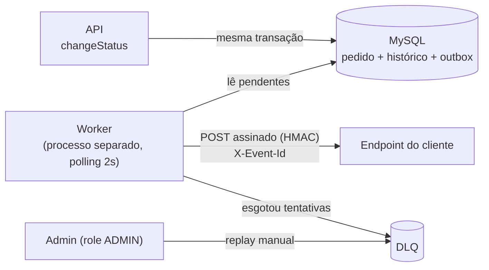

# RFC: Webhooks de notificação de mudança de status de pedidos

| Campo | Valor |
| --- | --- |
| **Autor** | `<autor>` |
| **Status** | Em revisão |
| **Data** | não informada (a reunião de origem registra apenas "quinta-feira, 09:00") |
| **Revisores** | Larissa (Tech Lead), Marcos (Product Manager), Bruno (Eng. Pleno, Pedidos), Diego (Eng. Sênior, Plataforma), Sofia (Eng. de Segurança) |
| **Documentos relacionados** | [ADRs](adrs/README.md) · [FDD](FDD.md) (detalhe de implementação) · [PRD](PRD.md) |

## Resumo (TL;DR)

Propomos notificar clientes B2B, via webhooks **outbound**, sempre que o status de um pedido deles mudar, com latência abaixo de 10 segundos. A mudança de status passa a gravar o evento numa tabela de **outbox no MySQL existente**, na mesma transação. Um **worker em processo separado** lê essa tabela a cada 2 segundos e entrega os eventos por HTTP:

- **Assinatura:** HMAC-SHA256, com uma secret por endpoint.
- **Garantia de entrega:** at-least-once, com `X-Event-Id` para o cliente deduplicar.
- **Falhas:** 5 tentativas com backoff exponencial; depois disso o evento vai para uma DLQ, com replay manual.

Não entra infraestrutura nova, e o módulo segue os padrões do projeto. Ficam fora: webhooks inbound, painel visual, e-mail de alerta e escala para vários workers.

## Contexto e problema

Três clientes B2B pediram para ser notificados quando o status dos pedidos deles muda. Hoje eles consultam `GET /orders` periodicamente, o que torna a integração lenta e cara, e um deles sinalizou que pode migrar para um concorrente ([09:00] Marcos). Para esses clientes, "tempo real" é qualquer coisa abaixo de 10 segundos ([09:02] Marcos). O fluxo é só de saída: os clientes querem receber, não enviar ([09:02] Marcos, [09:03] Sofia).

A solução tem três restrições:

- **A transação de mudança de status já é pesada.** Ela atualiza o pedido, grava o histórico e ajusta o estoque, e uma chamada HTTP no meio dela travaria outros pedidos ([09:04] Bruno). Essa transação é o `this.prisma.$transaction` de `changeStatus` em `src/modules/orders/order.service.ts`.
- **O time é pequeno**, e subir infraestrutura nova é visto como exagero ([09:07] Diego).
- **O projeto já tem padrões estabelecidos** de módulo, erros, logging, validação e autorização, e a feature deve segui-los ([09:27] Bruno, [09:30] Larissa).

## Proposta técnica

### Visão geral

### Componentes

- **Outbox transacional.** Toda mudança de status que algum endpoint do cliente quer ouvir grava um evento numa tabela de outbox, dentro da transação de `changeStatus`. Se a mudança de status sofre rollback, o evento some junto. O evento guarda um snapshot do payload tirado no momento da gravação ([ADR-001](adrs/ADR-001-outbox-no-mysql.md)).
- **Integração com o código atual.** A gravação é feita por uma função pura que recebe o client da transação. Se ela falhar, a mudança de status é desfeita. O filtro por status que cada endpoint quer ouvir é aplicado nesse momento ([ADR-007](adrs/ADR-007-integracao-changestatus-transacional.md)).
- **Worker de entrega.** Roda num processo próprio, com seu próprio client do banco, e busca os eventos pendentes a cada 2 segundos. A latência no pior caso é de 2s, dentro do limite de 10s ([ADR-002](adrs/ADR-002-worker-separado-polling-2s.md)).
- **Ordem.** Um único worker processa os eventos na ordem de criação, o que garante a ordem por pedido, mas não entre pedidos diferentes ([ADR-008](adrs/ADR-008-ordering-single-worker-por-order-id.md)). A garantia vale no caminho sem falhas. Com retry, um evento posterior do mesmo pedido pode passar à frente (ver Q5).
- **Resiliência.** Uma chamada que não responde em 10s conta como falha ([09:42] Diego). São 5 tentativas, com backoff de 1m, 5m, 30m, 2h e 12h. Esgotadas as tentativas, o evento vai para uma DLQ em tabela separada, com replay manual restrito a ADMIN ([ADR-003](adrs/ADR-003-retry-backoff-exponencial-e-dlq.md)).
- **Autenticidade.** O corpo de cada envio é assinado com HMAC-SHA256, usando uma secret única por endpoint, gerada pela plataforma. Na rotação, a secret antiga continua válida por mais 24h ([ADR-004](adrs/ADR-004-hmac-sha256-secret-por-endpoint.md)).
- **Semântica de entrega.** A entrega é at-least-once: cada evento leva um UUID em `X-Event-Id`, e o cliente deduplica por ele ([ADR-005](adrs/ADR-005-at-least-once-x-event-id.md)).
- **Módulo e padrões.** O módulo de webhooks replica a estrutura dos módulos existentes e reaproveita:
  - os erros baseados em `AppError`, com prefixo `WEBHOOK_`;
  - o logger Pino;
  - o middleware de erro;
  - a validação com Zod;
  - o `requireRole` para autorização.

  O CRUD de configuração aceita qualquer usuário autenticado ([ADR-006](adrs/ADR-006-reuso-padroes-do-projeto.md)).

Dois pontos são requisitos não funcionais, não decisões de arquitetura:

- a URL do webhook tem de ser HTTPS ([09:23] Sofia);
- o payload tem limite de 64KB, e acima disso o envio dá erro em vez de truncar ([09:24] Larissa).

Contratos (endpoints, payload, headers), modelo de dados e matriz de erros estão no [FDD](FDD.md).

### Fora de escopo

- **Webhooks inbound** (o cliente enviar para a plataforma): descartado. Os clientes só querem receber ([09:02] Marcos).
- **Painel visual** para o cliente: descartado nesta feature. A entrega é só por endpoints, e o painel é um projeto separado do time de frontend ([09:40] Larissa).
- **E-mail avisando o cliente** quando o webhook dele falha repetidamente: adiado para uma próxima fase, depois de medir o impacto ([09:37] Larissa).
- **Arquivamento das linhas já entregues da outbox:** reconhecido como necessário, mas fora desta feature ([09:08] Diego). Ver Q3.
- **Vários workers em paralelo:** adiado ("problema do futuro") ([09:13] Diego). Ver Q2.

## Alternativas consideradas

### Disparo síncrono dentro do service de pedidos

- **Descrição:** fazer a chamada HTTP ao cliente dentro da mudança de status.
- **Por que foi descartada:** um cliente lento travaria a mudança de status de outros pedidos ([09:04] Bruno). E, com o cliente fora do ar, não daria para desfazer a mudança de status ([09:04] Bruno, [09:06] Diego).

### Fila dedicada (Redis Streams ou similar)

- **Descrição:** publicar os eventos numa fila externa em vez de numa tabela do MySQL.
- **Por que foi descartada:** exigiria subir infraestrutura nova, o que é exagero para um time pequeno. A outbox no MySQL existente resolve ([09:07] Larissa, [09:07] Diego).

### Notificação reativa por trigger de banco

- **Descrição:** usar um trigger para acordar o worker no momento em que o evento é gravado, em vez de polling.
- **Por que foi descartada:** o MySQL não tem um mecanismo de notificação a processo externo como o `NOTIFY/LISTEN` do Postgres, e um trigger só executa SQL. Avisar o worker exigiria um improviso, enquanto o polling de 2s já atende o requisito ([09:09] Diego).

### Worker dentro do processo da API

- **Descrição:** rodar o loop de entrega na mesma instância da API.
- **Por que foi descartada:** quando a API reinicia, o worker cai junto ([09:11] Diego).

### Entrega exactly-once

- **Descrição:** garantir que cada evento chegue uma única vez.
- **Por que foi descartada:** exigiria coordenação dos dois lados e é muito mais complexo. At-least-once com identificador de evento resolve a grande maioria dos casos e é o padrão de mercado ([09:25] Diego).

## Questões em aberto

| # | Questão | Por que está em aberto | Levantada por |
| --- | --- | --- | --- |
| Q1 | Limitar a taxa de envio por cliente? Por exemplo, 50 mudanças de status num minuto geram 50 chamadas. | Ficou fora do escopo. A combinação foi observar e implementar se virar problema ([09:39] Diego, [09:39] Larissa). | [09:38] Diego |
| Q2 | Como escalar para vários workers sem perder a ordem por pedido: particionar por pedido ou usar lock pessimista? | Adiado como "problema do futuro"; nenhuma das duas opções foi escolhida. | [09:13] Bruno, [09:13] Diego |
| Q3 | Qual a política de arquivamento dos eventos já entregues? | Foi citado "30 dias ou assim" como ordem de grandeza, mas o tema ficou fora do escopo da feature, sem dono nem prazo. | [09:08] Diego |
| Q4 | Quando e como restringir a autorização do CRUD de configuração, que hoje aceita qualquer usuário autenticado? | Aceito assim por enquanto, com a intenção declarada de restringir mais tarde. | [09:36] Marcos, [09:37] Sofia |
| Q5 | Quando um evento entra em retry, segurar os eventos seguintes do mesmo pedido (ordem estrita, com atraso de até ~15h) ou aceitar que eles passem à frente? | Ordem ([09:12] Diego) e retry ([09:17] Diego) foram decididos separadamente, e a reunião não tratou dessa interação. A inversão é uma inferência registrada no [ADR-008](adrs/ADR-008-ordering-single-worker-por-order-id.md). | Levantada na revisão dos documentos, não na reunião |

## Impacto e riscos

### Impacto no sistema existente

- **`src/modules/orders/order.service.ts`:** `changeStatus` passa a chamar a função de gravação do evento dentro do `this.prisma.$transaction` que já existe. É a única alteração crítica em código existente ([09:40] Bruno; [ADR-007](adrs/ADR-007-integracao-changestatus-transacional.md)).
- **`prisma/schema.prisma`:** ganha as tabelas de configuração, outbox, DLQ e histórico de entregas. A modelagem está no FDD.
- **Ponto de entrada novo**, análogo a `src/server.ts`, com script próprio em `package.json` e um client criado por `createPrismaClient()` (`src/config/database.ts`) ([09:11] Larissa, [09:30] Bruno).
- **Módulo novo** espelhando `src/modules/orders/`. `src/middlewares/error.middleware.ts` e `src/shared/logger/index.ts` não mudam ([09:29] Bruno), e o `requireRole` de `src/middlewares/auth.middleware.ts` é reaproveitado no replay ([09:36] Larissa).
- **Operação:** passa a existir um processo a mais para operar e monitorar ([ADR-002](adrs/ADR-002-worker-separado-polling-2s.md)).

### Riscos

| Risco | Impacto | Mitigação | Origem |
| --- | --- | --- | --- |
| Prazo: a Atlas quer a entrega para fim de novembro, com risco de migrar para o concorrente | Perda comercial | Estimativa de 3 sprints, com a revisão de segurança incluída; prazo confirmado com o cliente pelo PM | [09:00] Marcos, [09:45] Marcos, [09:46] Larissa, [09:47] Marcos |
| A revisão de segurança (HMAC e geração de secret) bloqueia o deploy | Atraso na entrega | Reservar pelo menos 2 dias úteis de revisão antes do deploy | [09:46] Sofia, [09:47] Larissa |
| O cliente recebe o mesmo evento mais de uma vez (at-least-once) | Processamento duplicado do lado do cliente | Documentar a deduplicação por `X-Event-Id` com destaque no portal do desenvolvedor | [09:25] Sofia, [09:26] Marcos |
| O cliente fica fora do ar por mais tempo que a janela de retry (~15h) | Eventos vão para a DLQ e não são entregues automaticamente | Aceito; resta o replay manual pela DLQ | [09:17] Marcos, [09:18] Diego |
| O cliente vaza a própria secret | Envios forjados para aquele endpoint | Uma secret por endpoint limita o dano a um cliente, e a rotação tem 24h de convivência | [09:21] Sofia, [09:22] Diego |
| Rajadas de envio para um mesmo cliente | Sobrecarga no endpoint do cliente | Não implementada; observar (ver Q1) | [09:38] Diego, [09:39] Larissa |
| Com retry, o cliente recebe eventos do mesmo pedido fora de ordem | O cliente vê um status anterior chegar depois do seguinte | Mitigação não decidida (ver Q5); o payload leva `from_status`, `to_status` e o momento da mudança, o que permite reconciliar | [ADR-008](adrs/ADR-008-ordering-single-worker-por-order-id.md) |
| A vazão fica limitada a um único worker | Atraso na entrega se o volume crescer | Mitigação não discutida; a estratégia de escala está em aberto (ver Q2) | [09:13] Diego |

## Decisões relacionadas

| ADR | Decisão | Status |
| --- | --- | --- |
| [ADR-001](adrs/ADR-001-outbox-no-mysql.md) | Usar o padrão Outbox no MySQL existente para disparar os webhooks | Aceito |
| [ADR-002](adrs/ADR-002-worker-separado-polling-2s.md) | Rodar o worker de entrega em processo separado, com polling de 2 segundos | Aceito |
| [ADR-003](adrs/ADR-003-retry-backoff-exponencial-e-dlq.md) | Retry com backoff exponencial em 5 tentativas e DLQ para falhas definitivas | Aceito |
| [ADR-004](adrs/ADR-004-hmac-sha256-secret-por-endpoint.md) | HMAC-SHA256 com secret por endpoint, rotacionável com 24h de convivência | Aceito |
| [ADR-005](adrs/ADR-005-at-least-once-x-event-id.md) | Entrega at-least-once, com `X-Event-Id` para o cliente deduplicar | Aceito |
| [ADR-006](adrs/ADR-006-reuso-padroes-do-projeto.md) | Construir o módulo de webhooks sobre os padrões que o projeto já usa | Aceito |
| [ADR-007](adrs/ADR-007-integracao-changestatus-transacional.md) | Gravar o evento dentro da transação de `changeStatus` | Aceito |
| [ADR-008](adrs/ADR-008-ordering-single-worker-por-order-id.md) | Usar um único worker, garantindo a ordem apenas por pedido | Aceito |
